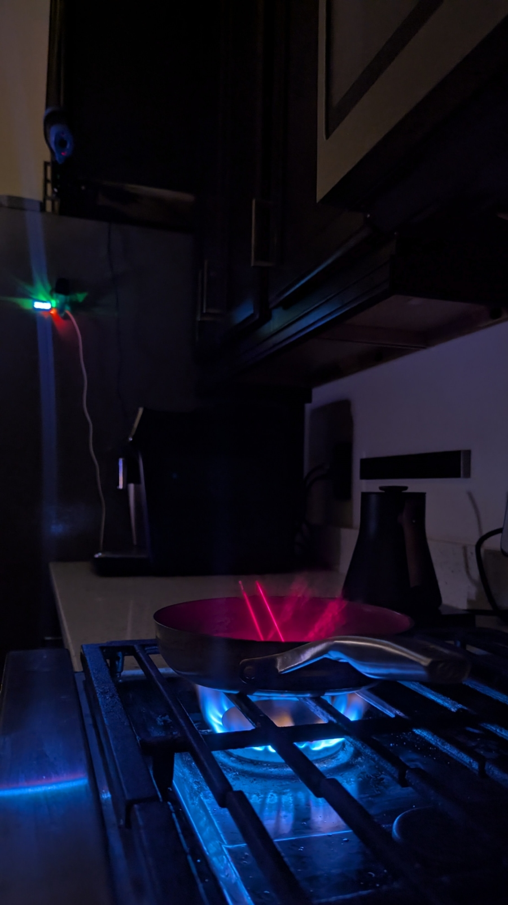
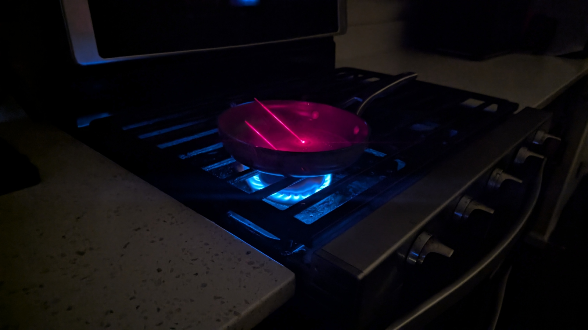
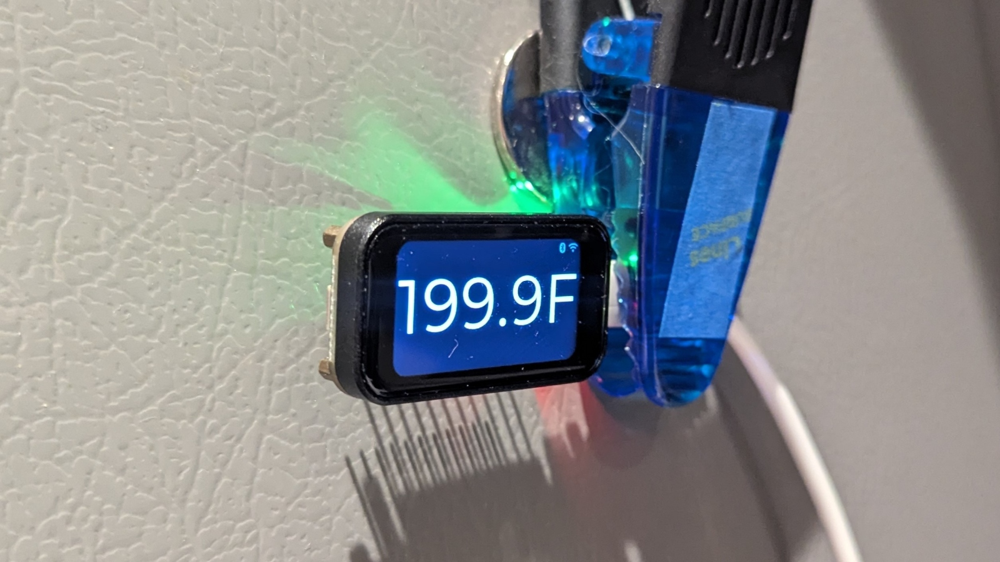
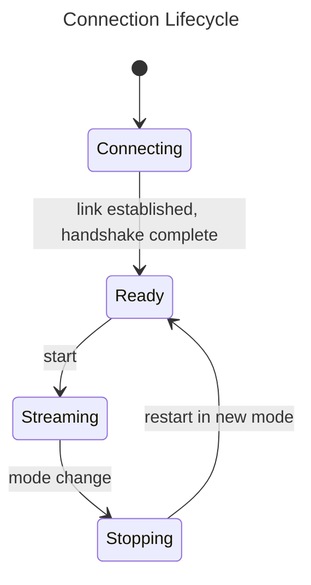
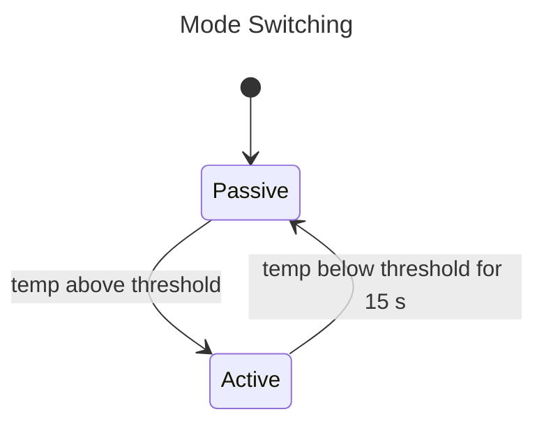

# Stove Sense
**IR thermometer and Bluetooth ESP32 display that automatically alerts when your skillet hits its target temperature.**

## Overview
A mounted IR thermometer passively monitors a cooking surface and streams temperature data over BLE to an ESP32 display for real-time monitoring. Hands-off by design, it automatically increases the polling rate as the surface heats up and sounds an audible alert when the target temperature is reached.

This was built because I really disliked the active waiting when preheating a pan and just wanted something to give me a heads up while I made coffee and breakfast.

*Laser briefly turns on when above temperature threshold to indicate that high polling rate is now active, as well as confirming sensor alignment is correct*

## What I Built
- **Firmware:** integrated NimBLE-Arduino library into custom firmware with a state machine design for automatic pairing and temperature data-streaming
- **Reverse engineering:** extracted the BLE protocols to receive data and send commands to the thermometer 

## Hardware
- **Display:** ESP32-C6-Touch-LCD-1.47 
- **IR Thermometer**
- **Magic Arm Clamp**
  

## Tech Stack
`Arduino` · `C++` · `NimBLE-Arduino` · `LVGL`

## Architecture

*Figure 1. Connection Lifecycle State Machine Diagram*

I chose to implement a state machine for this project instead of an event-driven design, partly as an educational exercise but also for its simplicity as it allows for easy debugging (especially since there are only a handful of states to deal with).

## Challenges & Tradeoffs
### Bluedroid vs NimBLE
Many tutorials recommend using Bluedroid but when using it, I couldn't establish a stable BLE connection, stalling at the handshake phase. Additionally, since I only needed BLE, the Bluedroid stack used more memory than necessary. I swapped to the NimBLE-Arduino library for BLE and to my delight, I saw a burst of activity and traffic between the client and server devices as they completed their handshake.

### BLE Connection Terminates After 40 Seconds
A bug in ESP32-C6 manufacturer firmware terminated BLE connections after 40 seconds. I traced the bug through the NimBLE library and discovered that the bug had to do with some handshake not completing within the set time interval.
Since the bug is located in proprietary closed source firmware, I could not patch it myself. I then accidentally discovered a workaround by sending additional connection update requests. My working theory is that a certain handshake process stalls and by forcing it to renegotiate connection parameters, it is able to successfully complete the handshake. There were open bug reports related to this issue and I've documented my fix: [h2zero/NimBLE-Arduino#1161](https://github.com/h2zero/NimBLE-Arduino/issues/1161)
 

### Passive vs. Active Modes
Implementing a slow polling passive mode could potentially conserve battery power or decrease the congestion of BLE traffic (which could be significant in a multi-device scenario). The sensor runs in a low-activity passive mode while the pan is cold and switches to an active mode once the surface passes a set threshold. Going back to passive requires the temperature to stay below the threshold for 15 seconds, so a pan temperature dipping briefly doesn't flip the mode back and forth. I felt it was important to prevent a whiplash effect since raw temperature data can be fairly noisy. Each switch stops the stream and restarts it in the new mode, with retries if the device doesn't respond.

*Figure 2. Mode Switching Diagram*

## Results
**Long term performance**: Tested and operated continuously 24/7 for 20 weeks. Power brownouts were the most common source of interruption and put the device in a frozen state. Power cycling resolved the issue each time. Future implementations should add a hardware watchdog for automatic brownout recovery.

**User Feedback**: Very positive with minor notes for improvement. Users found it very useful especially when making eggs in nonstick pans, which can be damaged or create dangerous fumes if overheated. One user remarked that it relieved an active source of anxiety for them in the kitchen. However, one user did not appreciate the mode changes as the device made a beep sound whenever it did this. This can be addressed by raising the mode-change threshold so that ambient heat, such as an oven preheating beneath the stovetop, doesn't trigger it.

## Status
Exploring options for a polished consumer-ready ESP32 product: larger screen with built-in battery for wireless experience or a circular knob display for a more natural and ergonomic interface.

## Contact
[LinkedIn](https://linkedin.com/in/vlucent)
 

---
*© 2026 vlucent. All rights reserved.*